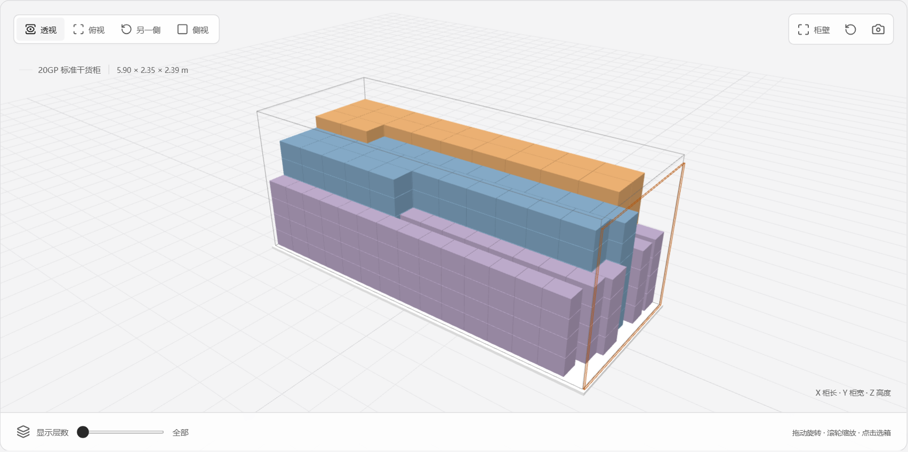

# 柜算 LOADPLAN｜免费开源的装柜计算工具

**这一批货，需要几个柜？怎么混装？还有多少没装进去？**

柜算是一款面向外贸业务员、跟单员、工厂和仓库人员的免费集装箱装柜计算工具。填写货物的外包装尺寸、数量和重量，就能估算装柜数量，查看柜内摆放图，并导出 Excel 或 PDF 报告，方便与同事、客户和仓库沟通。

本地开发版 v0.3.0 新增通用 `.xlsx` 导入、按形态填写尺寸和支撑占位、指定多柜混装、自动估算柜数、整批报告及 OBJ 导出。下方在线及正式下载链接仍指向已发布版本，本地改动不会自动发布。

## v0.3.0 新增流程

- **三步向导**：整理货物 → 设置柜子 → 查看方案。桌面端保持左右分屏：左侧选择模式，弹窗录入，右侧显示清单摘要或装载结果。首屏货物清单为空，不预填示例；计算成功后进入结果。可返回修改，输入变化后必须重新计算。
- **货物组合**：整理货物时选择“单一产品装柜”或“多种产品混装”。单一模式只保留一个规格，Excel 导入默认替换该规格；混装模式开放添加多个规格并允许多型号 Excel 导入。
- **弹窗编辑**：左侧保留货物导航摘要及橙色“导入 Excel”入口；点击货物组合方式或柜子计算方式打开对应弹窗，弹窗仅编辑所选模式。完成按钮位于内容底部居中，可用 Esc 关闭。右侧上方统一显示当前货物汇总表，装载预览仍在下方保留；桌面步骤导航合并为单行居中。
- **指定多柜**：以统一列表选择柜型及数量，选择或添加柜型自动带入默认内尺寸、柜门及载重，可展开修改参数；支持自由添加、删除，至少保留一行。
- **常驻导航**：左侧直接选择单一产品/多种产品混装，以及单柜/指定多柜/自动估算，点击当前模式也能再次打开对应弹窗。Excel 在独立导入弹窗操作。混装切换单一产品时先确认保留规格；底部始终提供计算入口。顶部“计算步骤提示”保留整理货物、设置柜子、查看方案三个进度。
- **按需导出**：仅在结果步骤点击“导出方案”，选择 Excel、PDF 或 OBJ 和导出范围，再生成文件。选择 OBJ 时才显示框架与材质选项。
- **货物尺寸**：先选形态。长方体、木箱和木架填写外尺寸；圆柱填写直径和高度或轴向长度，占位自动生成。有底座或防滚支架时勾选支撑设置，再调整含支撑整体占位及毛重。
- **Excel 导入**：选择 `.xlsx` 和工作表，设置表头及数据起始行，核对字段映射和尺寸、重量单位。支持分列或长×宽×高组合尺寸、中英文表头、行级修正和按产品筛选批量补充；缺失毛重必须补齐。可追加或替换清单、保存本机映射并下载空白模板。旧 `.xls` 请先另存为 `.xlsx`。
- **含支撑尺寸导入**：选择表中长宽高为含支撑整体占位，并另行映射本体直径及轴向长度。普通产品尺寸与支架外尺寸不能混为一组数据。
- **混装和追踪**：每条货物独立选择形态、朝向、叠放和底层规则。相同产品与规则可汇总数量，保留每件序列号及原始工作表行号；同型号不同尺寸、重量或规则不合并。
- **指定多柜**：选择“指定多个柜子”，设置当前柜型数量，也可添加其他柜型并独立修改内尺寸、柜门、载重和间隙。按配置顺序逐柜分配，空柜和剩余货物均保留。
- **估算柜数**：选择“自动估算柜数”，设置可用柜型、优先顺序和组合目标。每柜尽量多装或严格按柜型优先级，装完或无进展停止。结果为启发式方案，不保证最少柜数，不计算运价。
- **逐柜与整批结果**：切换柜号查看该柜三维及序列号。导出范围可选当前柜或整批；整批 Excel 含汇总、每柜模型图、逐件位置及未装入清单，PDF 含汇总及逐柜报告。
- **OBJ**：可单独导出当前柜 `.obj`，多柜逐柜打包；可选包含柜体框架和 `.mtl` 颜色材质。默认导出全部层和实际占位尺寸。OBJ 为毫米、Y 向上，X 柜长、Z 柜宽，原点在柜内角点。支撑结构仍为示意。
- **结果状态**：修改输入后，旧图明确标记为上次结果，重新计算前不能导出。计算可取消。

当前每批最多 200 种规格、50 柜，货物件数不设 1500 件限制；数量须为可精确计算的整数，实际装入量由空间、载重与叠放规则决定，其余保留为剩余。导入文件最多 20 MB，解压内容最多 60 MB，每工作表最多 10000 行和 100 列。单柜计算限时 15 秒；多柜分配在约 90 秒预算后于柜间停止，界面有 120 秒保护超时。映射与文件解析在本机完成。

混装仍仅允许同规格上下对齐堆垛，不支持跨规格互相叠压、圆柱交错嵌套、真实异形碰撞或现场搬运路径模拟。

**[直接在线使用](https://loadplan-fleix.vercel.app) · [下载 Windows / Mac 单机版](https://loadplan-fleix.vercel.app/downloads.html)**

无需注册。打开网页即可使用，也可以下载到电脑，断网时照常计算。

## 能帮你做什么

| 你想知道的事 | 在柜算里可以这样做 |
| --- | --- |
| 20 尺柜、40 尺柜或高柜能装多少货？ | 选择 20GP、40GP 或 40HQ，填写货物后试算。 |
| 多种规格的纸箱放在一起，能不能装下？ | 添加不同产品，查看每种货物已装和未装的数量。 |
| 有没有能多装一些的摆法？ | 比较两种装柜方案，查看数量和摆放图后选择。 |
| 货物在柜里怎么摆？ | 旋转、放大 3D 图，切换俯视或侧视，也能逐层查看。 |
| 有些货不能叠、不能侧放，怎么办？ | 设置摆放方向、是否允许叠放、最多层数、只能放底层等条件。 |
| 怎么把装柜结果发给仓库或客户？ | 导出 Excel 或 PDF，把数量、重量、摆放图和明细一起发出去。 |

*示例装柜图，使用模拟货物。不同颜色对应不同产品，橙色边框表示柜门。*

## 第一次使用，按这三步来

### 1. 整理货物

每种规格填一项：

- **产品名称**：点击名称或旁边的铅笔即可修改。
- **长、宽、高**：填写装柜时的外包装尺寸，单位是毫米（mm）。例如 60 × 40 × 40 厘米的纸箱，填写 **600 × 400 × 400**。
- **数量**：填写这次准备装柜的箱数或托数。
- **毛重**：填写每箱或每托连同包装的总重量，单位是千克（kg）。
- **摆放要求**：按实际情况设置能否转向、能否叠放、最多几层，以及是否只能放底层。

有多种产品，点击 **“添加货物规格”** 继续填写；也可以通过 **“导入 Excel”** 批量录入 `.xlsx` 货物清单。

### 2. 设置柜子

点击“下一步：设置柜子”，选择单柜、指定多柜或自动估算。可选 **20GP、40GP、40HQ**，并根据实际柜况修改内尺寸、柜门和载重。自动估算可设置参与计算的柜型和优先顺序。

### 3. 查看方案与导出

点击 **“计算装柜方案”**，查看已装数量、未装数量、已装毛重，以及用了多少柜内空间。

在 **“比较装柜方案”** 中点击 **“重新比较”**，可以查看另一种摆法。选择要查看的方案后，下面的 3D 图和货物明细会一起更新。

拖动图片可以转动视角，滚轮可以放大、缩小；也可以从上面、侧面查看，或逐层检查货物位置。

点击结果页的“导出方案”，选择文件格式和导出范围，再点击“生成文件”。OBJ 的模型选项只在选择 OBJ 后出现。

- **导出 Excel**：装载概况、3D 图和货物明细放在同一个工作表里，方便查看、编辑和打印。
- **导出 PDF**：生成排版好的装柜报告，方便转发和打印。
- **单独保存图片**：点击 3D 图右上角的相机按钮。

报告使用你当前选中的方案。导出的 3D 图保留当前查看角度，并显示全部货物层。

**修改货物后，请重新计算再导出。关闭或刷新页面前，请先导出需要保留的报告。**

## 纸箱、整托和其他货物怎么填

| 装柜时是什么样子 | 应该填写什么 |
| --- | --- |
| 纸箱、木箱 | 外包装的最大长、宽、高，以及每箱毛重。 |
| 整托货物 | 装载单位选择“整托”，填写托盘连同货物的整体尺寸、整托总重量和托数。 |
| 木架包装、裸装机器 | 填写能完整包住货物的最大长、宽、高，并设置是否允许叠放。木架内部的空隙不用于放入其他货物。 |
| 桶、卷材等圆柱货物 | 选择直立或横放。横放时，整体尺寸和重量要包含防滚支架；默认不叠放，勾选允许叠放后按同规格上下对齐计算，受层数、底层及每垛总重量限制，不支持交错排列。 |

例如：**花瓶装在纸箱里，就按纸箱外尺寸计算，不需要填写花瓶本身的形状。**

## 选择网页版，还是下载到电脑

| 使用方式 | 适合什么情况 |
| --- | --- |
| [在线网页版](https://loadplan-fleix.vercel.app) | 临时试算、第一次体验，不想安装软件。 |
| [Windows 单机版](https://loadplan-fleix.vercel.app/downloads.html) | 常见 Intel / AMD 电脑，64 位 Windows 10 或 11。 |
| [Mac Apple 芯片版](https://loadplan-fleix.vercel.app/downloads.html) | M 系列芯片的 Mac，macOS 12 或更新版本。 |
| [Mac Intel 芯片版](https://loadplan-fleix.vercel.app/downloads.html) | Intel 芯片的 Mac，macOS 12 或更新版本。 |

网页版和单机版都可以进行装柜计算、查看 3D 图和导出报告。**单机版安装完成后，无需联网使用。**

Mac 用户可以在苹果菜单的“关于本机”中查看芯片类型。首次安装遇到系统提示，请参阅[下载页面的安装说明](https://github.com/fleixweb/Loadplan/releases/latest)。

## 常见问题

**使用要收费吗？需要账号吗？**

不收费，也不需要注册账号。外贸公司、工厂和仓库都可以用它处理自己的装柜工作。

**产品清单会上传吗？**

货物数据和装柜计算在你自己的浏览器或电脑中处理，默认不上传业务数据。

**能直接导入我现有的产品 Excel 吗？**

支持导入 `.xlsx` 文件。导入时可以选择工作表、设置表头和数据起始行，并核对尺寸、数量和毛重字段。导出的 Excel 和 PDF 是结果报告，不能直接导回工具继续编辑。

**可以一次算多少货？**

每批最多填写 200 种规格，支持单柜、指定多柜及自动估算柜数，最多 50 柜。货物数量不设 1500 件限制；超过所选柜子容量的部分保留在剩余清单中。

**显示没装进去，就一定装不下吗？**

不一定。可以比较另一种方案，也可以核实摆放要求后重新试算。柜算目前不会把不同规格的货物互相叠放，现场可能存在其他摆法。

**能直接照着图安排装柜吗？**

摆放图适合用于装柜前的数量估算和沟通。实际装柜还需要核实包装承重、搬运空间、绑扎固定和运输要求。逐层查看不等于实际装货顺序。

**报告里能复制或修改文字吗？**

Excel 的明细可以编辑。当前 PDF 主要用于查看和打印，其中的文字不能直接选中复制。

## 联系作者

由 **Fleix** 开发维护。如果你在实际装柜中遇到问题，或有希望增加的功能，欢迎通过 [GitHub 反馈](https://github.com/fleixweb/Loadplan/issues) 或邮件联系：**45186482@qq.com**。

反馈时可以说明柜型、货物外尺寸、数量和希望的摆法；请勿附带客户等敏感信息。

## 开源与二次开发

柜算使用 [AGPL-3.0 开源协议](LICENSE)，并附有[作者署名和修改版标识要求](ADDITIONAL_TERMS.md)。如果你只是用来计算装柜，直接打开工具即可；如果要修改或发布软件，请先阅读完整条款。

开发与部署说明见[发布文档](docs/distribution.md)，第三方组件声明见[许可说明](public/third-party-notices.txt)。

© 2026 Fleix · 柜算 LOADPLAN · 免费开源的装柜计算工具
